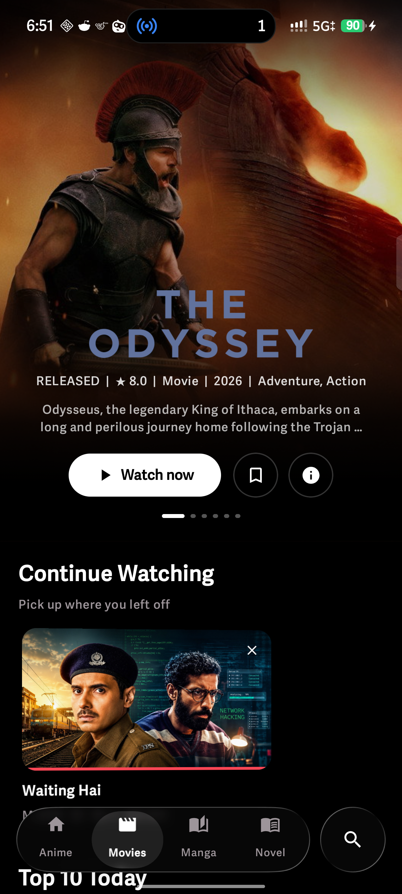
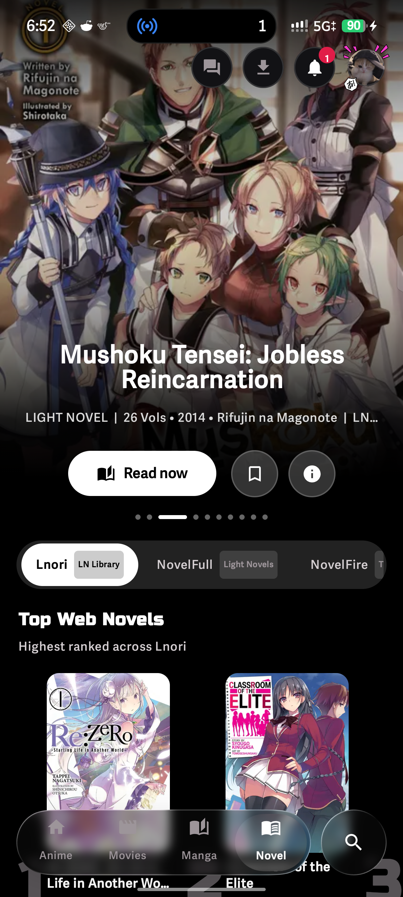
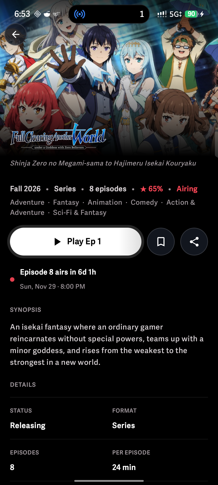
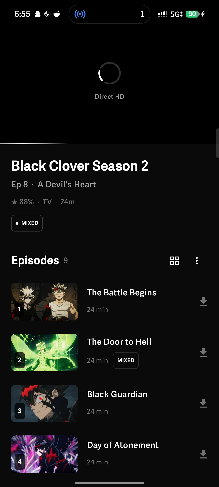
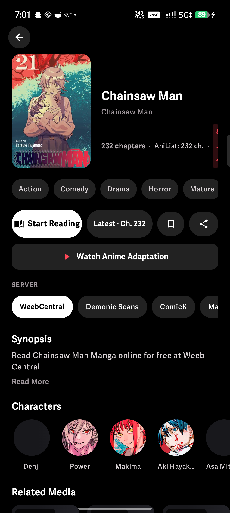

# Z E N K A I

**WATCH · READ · DISCOVER**

Anime, Movies, Manga & Novels — one focused Android experience.

 

 

  

<a href="https://github.com/Nyyrox/Zenkai/releases/latest">Download APK</a>
&nbsp; · &nbsp;
<a href="https://zenkaii.pages.dev/">Web App</a>
&nbsp; · &nbsp;
<a href="https://discord.gg/aXTfS6XGg">Discord</a>
&nbsp; · &nbsp;
<a href="https://t.me/StreamverseOfc">Telegram</a>

---

## ✦ The Zenkai Experience

Zenkai unifies **Anime streaming, Movies & TV Shows, Manga reading, and Light Novels** into a single, high-performance Android application crafted with Jetpack Compose.

| 🍿 Movies & TV | 🎬 Anime | 📖 Manga | 📚 Novels |
|:---:|:---:|:---:|:---:|
| Direct HD streams, 4K metadata & multi-source playback | Multi-server streaming, Dub/Sub audio selector & PiP | Multi-provider reader, chapter downloads & sync | Minimal, distraction-free reader for long-form stories |

---

## 📱 Screenshots

  <table>
    <tr>
      <td align="center" width="20%">
        <b>Movies & TV Shows</b>  
        
      </td>
      <td align="center" width="20%">
        <b>Light Novels</b>  
        
      </td>
      <td align="center" width="20%">
        <b>Anime Details & Airing</b>  
        
      </td>
      <td align="center" width="20%">
        <b>Direct HD Player</b>  
        
      </td>
      <td align="center" width="20%">
        <b>Manga Reader & Chapters</b>  
        
      </td>
    </tr>
  </table>

---

## 🌐 Zenkai Web

The Zenkai experience is also available directly in your browser.

**[Open Zenkai Web →](https://zenkaii.pages.dev/)**

---

## 🍿 Movies & TV Series

- **TMDB Integration**: Enriched metadata, artwork, and trending lists routed through Cloudflare Gateway.
- **Direct HD Streaming**: MovieBox resolvers with multi-source fallback for smooth, reliable playback.
- **Episode & Season Browsing**: Clean episode lists with thumbnails, air dates, and overview summaries.
- **Offline Downloads**: High-speed downloads for movies and episodes with resilient background service.

## 🎬 Anime

- **Unified OTT Interface**: Modern, clutter-free home layout harmonized with Movies, Manga, and Novels.
- **CinePlayer Engine**: High-performance video player with auto-hiding controls and smooth scrubbing.
- **Instant Dub / Sub Audio**: Automatic audio stream detection and seamless switching between Sub and Dub tracks.
- **Picture-in-Picture (PiP)**: Keep watching while navigating across other apps.
- **AniSkip Support**: Smart automated intro and outro skipping.
- **Offline Downloads**: Background download service with storage tracking and notification controls.

## 📖 Manga

- **Multi-Source Aggregation**: Seamless reading across WeebCentral, Demonic Scans, Comick, and MangaDex.
- **Fast Reader Engine**: Flexible viewer modes (webtoon vertical scroll, right-to-left, left-to-right).
- **Chapter Downloads**: Download entire chapters for completely offline reading.
- **Progress Tracking**: Automatic synchronization with your AniList and Zenkai profiles.

## 📚 Light Novels & Web Novels

- **Clean Typography**: Distraction-free, responsive reading interface designed for long sessions.
- **Diverse Sources**: Direct catalog integration with Lnori, NovelFull, and NovelFire.
- **Bookmark & Chapter Cache**: Pick up exactly where you left off, online or offline.

## ⚡ Ascension & Gamification

- **Leveling Engine**: Unified progression tracking combining your watched anime hours, read manga chapters, and novel pages.
- **Quests & Milestones**: Daily and weekly challenges to unlock exclusive ranks, titles, and decorations.
- **Community Leaderboard**: Compare ranks and achievements with fellow Zenkai members.

## 💬 Community & Direct Messaging

- **Real-Time Channels**: Engage in discussions across dedicated channels (`#general`, `#episode-talk`, `#recommendations`).
- **Monochrome Dark Bubbles**: Clean, distraction-free chat UI with optimistic instant message delivery.
- **Direct Messaging**: 1-on-1 private messaging with instant profile caching and no loading delays.
- **Messages Inbox**: Convenient inbox accessible right from your personal profile.
- **Media Tagging**: Tag anime, movie, manga, or novel titles directly into the chat conversation.

## 🎨 Profile & Personalization

- **Profile Customization**: Webapp-aligned banner, custom avatar frames, and animated borders.
- **Typography Effects**: Dynamic custom fonts including Syne, JetBrains Mono, Nosifer, and more.
- **Personal Library**: Centralized watchlist, favorites, continue-watching history, and download manager.

---

## 🆕 Latest Release · v1.6.9

| Feature | Highlight |
|---|---|
| 🎬 **Movies & Series** | Full TMDB catalog integration with MovieBox Direct HD streams |
| 📺 **OTT Anime Redesign** | Modernized OTT home screen matching Movies, Manga, and Novels |
| 💬 **Direct Messaging & Inbox** | Private 1-on-1 messaging with instant profile cache and dedicated inbox |
| 🫧 **Monochrome Chat** | Refined group chat bubbles, optimistic sending, and auto-scroll to latest |
| ⚡ **Ascension System** | Unified level calculation, quest progression, and profile hero alignment |
| 📥 **Enhanced Downloads** | Resilient background downloading, storage tracking, and fast single-track audio |
| 🚀 **Performance** | Zero frame lag, instant startup, and streamlined memory consumption |

**[View v1.6.9 Release & Download APK →](https://github.com/Nyyrox/Zenkai/releases/latest)**

---

## 🔐 Security

Every Zenkai release is compiled and scanned with **VirusTotal** for independent antivirus verification.

> VirusTotal results can change as antivirus engines update their definitions. The scan report confirms clean, safe builds.

**[View VirusTotal Scan Report →](https://www.virustotal.com/gui/file-analysis/NThjZTA0YThkNzNmYQ2YzM3Njc4YjZjNGU4ZjdiYzA6MTc4OTA1NjAyMQ==)**

---

## ⚠️ Disclaimer

Zenkai does not host any media files on its servers and has no affiliation with the content providers available through the application. All media is fetched from publicly available third-party services and APIs. For legal inquiries, please contact the respective file hosts and copyright owners.

---

### ZENKAI

**One place for what you watch. One place for what you read.**

 

<a href="https://github.com/Nyyrox/Zenkai/releases/latest"><strong>GET ZENKAI →</strong></a>

  

Built with passion by the Zenkai community.

